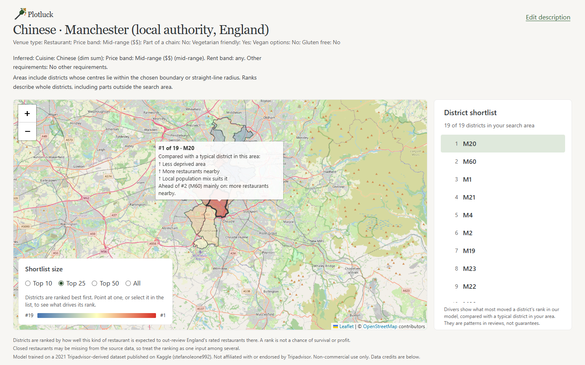
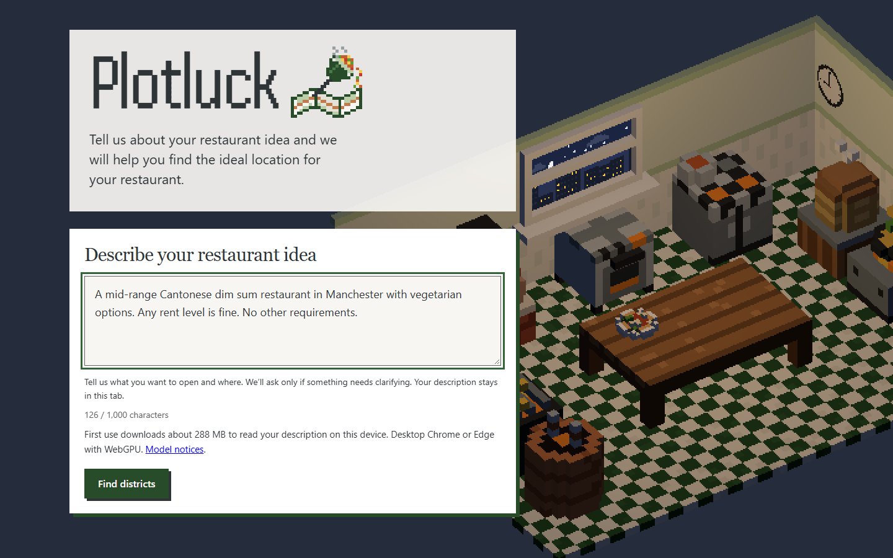
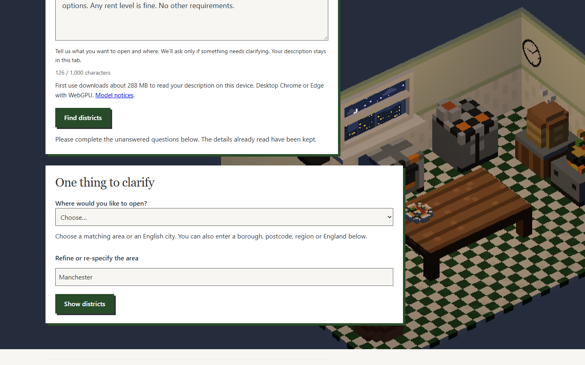

# Plotluck

**Where in England should your restaurant open?**

Plotluck is a free map tool for people planning a restaurant, especially small independents and cuisines that are under-represented where they live. You describe your idea in a sentence, and Plotluck ranks English postcode districts by how well a restaurant like yours is expected to do with reviewers there.

**Try it:** https://adrielau.github.io/PlotLuck/ (desktop Chrome or Edge with WebGPU)

Created by **Team Jellyfishes.AI** in 24 hours for the **IBM Z Datathon 2026** (Wildcard → Community Impact), with models trained on **IBM LinuxONE**.



## Why we built it

A teammate's father's restaurant closed during COVID. Choosing a location is one of the biggest bets an independent owner makes, and it usually comes down to gut feel or expensive consultants. Big chains have site-selection teams; a family opening its first dim sum place does not. Plotluck gives that family a data-driven starting point for free, and it helps cuisines that are rare in an area find districts where they are likely to be welcomed.

## What it does

1. **Describe your idea in plain English.** For example: *"A mid-range Cantonese dim sum restaurant in Manchester with vegetarian options. Any rent level is fine."*

   

2. **Answer a question only if one is needed.** Plotluck needs six things: the area, cuisine, menu prices, rent, restaurant type and any other requirements. If your description covers all six, you go straight to results. If something is missing or ambiguous, Plotluck asks about that one thing and keeps everything else. Here, "Manchester" could mean the city or the wider local authority:

   

3. **Explore the ranked districts.** The map outlines each district in your search area and colours it by rank. A shortlist on the right puts the best first. Point at a district to see what drives its rank compared with a typical district nearby, such as lower deprivation, more restaurants nearby or a local population that suits the cuisine.

Plotluck shows ranks, not raw scores. A rank describes expected **review-based success**, meaning customer satisfaction and review activity. It is not a prediction of survival or profit, so treat it as one input to your decision alongside rent, foot traffic and a visit.

## How it works

```
 "A mid-range dim sum place in Manchester..."
        │
        ▼
 ┌─────────────────────────┐  cuisine, prices, venue type,     ┌──────────────────┐
 │ NN2                     │  requirements, rent, area         │ NN1              │
 │ integrated restaurant-  │ ─────────────────────────────────▶│ district-scoring │──▶ ranked map
 │ description interpreter │  (asks only for what is missing)  │ network          │    + driver summaries
 └─────────────────────────┘                                   └──────────────────┘
```

Plotluck uses two models, and both run on your own device. Your description never leaves the browser tab.

- **NN2, the integrated restaurant-description interpreter, reads your description.** It is a small open-source language model that runs in the browser through WebGPU (first use downloads about 288 MB). It turns free text into a structured profile and search area. Rule-based checks validate its output against an offline catalogue of English places and the cuisines NN1 knows. Anything invalid or unclear becomes a clarification question instead of a silent guess.
- **NN1, the district-scoring network, scores every district.** It is a small neural network (a 64 → 32 MLP) that takes the restaurant profile together with each district's context and predicts review-based success. That context covers population, deprivation, commercial rent, existing restaurant supply, age, detailed Census ethnicity (including the share of the community that matches the cuisine) and nearby attractions and hotels. It scores about 2,000 English postcode districts.
- **Driver summaries explain each rank.** For each district, the site swaps one group of factors at a time for those of the area's median district, re-scores it, and reports the factors that moved the rank most.

### Where IBM LinuxONE comes in

NN1 is trained in Jupyter on an **IBM LinuxONE** (s390x, big-endian) instance. That covers ingesting about 143,000 English restaurant listings, joining them to Census, rent and OpenStreetMap context, and running 5-fold cross-validation grouped by district. On held-out districts, the current model's error is 0.148 against a baseline of 0.250 (mean absolute error on a 0–1 percentile scale). The trained weights are exported as plain JSON and run with a JavaScript forward pass, and CI checks that the s390x weights produce the same scores on x86. NN2 inference was also evaluated on LinuxONE. Because the site is static and hosted on GitHub Pages, it stays live after the event ends.

Screenshots of the LinuxONE work are in [`docs/evidence/`](docs/evidence/), and run results are in [`runs/`](runs/).

## Project status

This is a hackathon build. The core flow works end to end on the live site. NN2's model-quality and release gates are still open, and clusters, driver charts and a "cultural demand gap" view are planned for later. The build status of each phase is in [PROGRESS.md](docs/competition/PROGRESS.md).

## Where to find more

| If you want… | Read |
|---|---|
| The pitch | [Pitch deck (PDF)](docs/competition/Plotluck_pitch_deck.pdf) · [initial design doc](docs/competition/Plotluck_Design_Doc.pdf) |
| The plan, open questions and platform facts | [PROJECT.md](docs/competition/PROJECT.md) |
| Build status | [PROGRESS.md](docs/competition/PROGRESS.md) |
| What we submit | [DELIVERABLES.md](docs/competition/DELIVERABLES.md) |
| How ranking works and how we audited it | [RANKING.md](docs/competition/RANKING.md) |
| How NN2 reads descriptions | [NN2 integration plan](docs/plans/nn2-integration.md) |
| Key decisions and their reasons | [Architecture decision records](docs/adr/) |
| Terms like "review-based success" | [GLOSSARY.md](GLOSSARY.md) |
| Data sources and licences | [data/SOURCES.md](data/SOURCES.md) |
| LinuxONE evidence | [docs/evidence/](docs/evidence/) · [run results](runs/) |
| Running the code yourself | [CONTRIBUTING.md](CONTRIBUTING.md) · [setup](docs/setup.md) · [server runbook](docs/server.md) |

## Running it locally

The site is static, so serve `web/` with any file server and open it in Chrome or Edge:

```sh
python -m http.server --directory web 8000
```

Tests run on the committed data sample: `pytest` for the Python package and `node --test` for the site. Full setup is in [docs/setup.md](docs/setup.md).

## Team Jellyfishes.AI

We are final-year (fourth-year) Aeronautical Engineering students at Imperial College London.

Adriel Au · Ahmed Gilani · Ansh Waddon · Erica Keung · Xavier Chen

## Dataset attribution and use

The team selected the Kaggle Tripadvisor-derived source for non-commercial training, accepting the unresolved source-rights risk under [ADR 0003](docs/adr/0003-train-on-tripadvisor-derived-data-publish-only-model-outputs.md). Raw restaurant rows remain on LinuxONE; committed restaurant samples are synthetic. Public outputs are limited to model weights, district scores, ranked districts and cuisine/trait pick-lists. Commercial use requires retraining on a permitted source.

Required attribution for the trained model:

> Model trained on a 2021 Tripadvisor-derived dataset published on Kaggle (stefanoleone992). Not affiliated with or endorsed by Tripadvisor. Scores reflect review-based success among restaurants listed in 2021; closed restaurants may be missing.

Census context: Source: Office for National Statistics licensed under the Open Government Licence v.3.0. Tourism counts: © [OpenStreetMap contributors](https://www.openstreetmap.org/copyright), ODbL. Geography attribution is recorded in [data sources](data/SOURCES.md).
